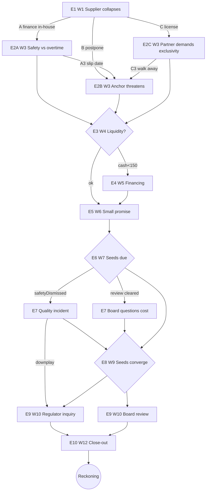

# Assume Their Life — Playable Scenario Map (pre-build design)

**Status:** DESIGN ONLY — satisfies the Spec §7 requirement for a one-page scenario map *before* any
coding. Not an authorization to build, and not a settled content script. Implementation needs separate
founder approval of a chosen role/scenario.

**Scenario used here is ILLUSTRATIVE FICTION.** To demonstrate the *causal structure* without making
claims about any real person, this map uses a **fictional analogue**: *Dayo Okoro, founder-CEO of
"Halcyon Mobility" (a fictional EV + satellite company)*. No real individual is depicted. A real
named-figure scenario would instead use **dated, sourced public baselines** with "hypothetical — not
affiliated/endorsed" labeling (Spec §4, §5).

Role pack: **Public tech entrepreneur.** Horizon: **12 weeks.** ~10 meaningful decisions, **3
interwoven arcs** (Supply/Launch, Liquidity/Financing, Media/Reputation), with visible delayed,
cross-domain consequences.

---

## 1. Situation Brief (the inherited situation, not a title)

> **Hypothetical fictional simulation.** Starting snapshot "as of" an illustrative date; in a real
> build these fields carry source citations and an estimate/confirmed flag.

- **Role:** Founder-CEO, Halcyon Mobility. Snapshot: *illustrative*.
- **What you control:** product & hiring, cash allocation (within liquidity), launch timing, public
  messaging. **What you don't:** paper net worth is **not** spendable cash; the board can remove you;
  customers/regulators/press react on their own.
- **Starting tensions:** a flagship launch is 12 weeks out; a critical battery supplier **just failed**;
  lenders, an anchor customer, a safety regulator and staff are all watching.
- **Goal:** no single "win". Survive, improve the company's position, and/or leave a defensible legacy.

### State variables (compact; role-adjusted)
| Var | Meaning | Start |
|---|---|---|
| `cash` | Liquid cash ($M) | 800 |
| `paperWorth` | Paper net worth ($B) — **not spendable** | 90 |
| `control` | Founder voting control (%) | 55 |
| `ops` | Operational capacity (0–100) | 60 |
| `morale` | Staff morale (0–100) | 65 |
| `board` | Board confidence (0–100) | 60 |
| `trust` | Customer trust (0–100) | 70 |
| `media` | Media sentiment (−100…100) | +10 |
| `regulator` | Regulator stance (−100…100) | 0 |
| `commitments[]` | Public/private promises the engine remembers | [] |
| `memory{}` | Stakeholder memories (engLead, anchor, partner, board…) | {} |
| `seeds[]` | Delayed events: `{id, fireWeek, condition}` | [] |
| `flags{}` | e.g. `safetyDismissed`, `independentReview`, `licensedIP`, `exclusivity`, `noLayoffsPromise` | {} |

**Event selection rule:** at each step the engine picks the next event from a candidate pool whose
**preconditions match current state + history** (and fires any due `seeds`). It is never a shuffled
list of generic questions.

---

## 2. Event graph (nodes, choices, deltas, follow-ons, delayed seeds)

Notation: `Δ` = immediate state change; **→Exx** = next event triggered on this path; **⏳seed** =
delayed consequence planted now, fires later if its condition holds.

### E1 — Week 1: The supplier collapses *(inciting; precondition: start)*
| Choice | Δ immediate | → next | ⏳ delayed seed |
|---|---|---|---|
| **A. Finance emergency in-house production** | `cash −250`, `ops +15`, `morale −10`, `control 0`; set `commitments+=["launch on time"]` | **→E2A** (eng lead: safety vs overtime) | ⏳`S_quality@W7` if `flags.safetyDismissed` |
| **B. Postpone launch, protect cash** | `cash −20`, `trust −10`, `media −5`; set `commitments+=["new date"]` | **→E2B** (anchor customer threatens to cancel) | ⏳`S_competitor@W8` (competitor gains if still delayed) |
| **C. License production to external partner** | `cash −60`, `ops +20`, `control −0`, margin↓; set `flags.licensedIP=true` | **→E2C** (partner demands designs + exclusivity) | ⏳`S_ipdispute@W9` if `flags.exclusivity` |

### E2A — Week 3: Engineering lead escalates a safety concern *(precondition: path A)*
| Choice | Δ | → next | ⏳ seed |
|---|---|---|---|
| **A1. Approve overtime, dismiss the concern** | `ops +10`, `morale −15`, `memory.engLead −`; `flags.safetyDismissed=true` | →E3 (liquidity check) | ⏳`S_quality@W7` (now armed): quality incident |
| **A2. Hire independent reviewers (costs time+cash)** | `cash −40`, `ops −5`, `trust +5`, `flags.independentReview=true`, `memory.engLead +` | →E3 | ⏳`S_reviewclears@W7`: review clears → board cost debate |
| **A3. Slip the date two weeks to do it right** | `trust −8`, `media −4`, `board −5`, `morale +8` | →E2B (now the anchor customer reacts to the slip) | — |

### E2B — Week 3: Anchor customer threatens to cancel *(path B, or reached from A3)*
| Choice | Δ | → next | ⏳ seed |
|---|---|---|---|
| **B1. Give a discount + firm new date** | `cash −80`, `trust +6`, `commitments+=["firm date"]` | →E3 | ⏳`S_datemiss@W10`: if date later missed → trust crash |
| **B2. Hold the line, offer priority allocation** | `memory.anchor −`, `trust −4` | →E3 | ⏳`S_anchorleaves@W9` if `trust<55` |
| **B3. Quietly ask the board for a bridge** | `board −6` (looks shaky) | →E4 (financing) | — |

### E2C — Week 3: Partner demands sensitive designs + exclusivity *(path C)*
| Choice | Δ | → next | ⏳ seed |
|---|---|---|---|
| **C1. Grant exclusivity for speed** | `ops +15`, `control 0`, `flags.exclusivity=true` | →E3 | ⏳`S_ipdispute@W9` armed; ⏳`S_lockin@W11` (can't switch suppliers) |
| **C2. Share designs, refuse exclusivity** | `ops +8`, `memory.partner −` | →E3 | ⏳`S_leak@W8` (design leak risk if `media<0`) |
| **C3. Walk away, keep control** | `cash −60`, `ops −10`, `control +0` | →E2B (back to the anchor problem, unsolved) | — |

### E3 — Week 4: Liquidity checkpoint *(precondition: always; branches on `cash`)*
- If `cash < 150` → **→E4** (forced financing). Else → **→E5** (a "small" choice).

### E4 — Week 5: Financing under pressure *(precondition: `cash<150` or came from B3)*
| Choice | Δ | → next | ⏳ seed |
|---|---|---|---|
| **D1. Raise debt** | `cash +300`, `board −5`; `commitments+=["debt covenants"]` | →E5 | ⏳`S_covenant@W11` if `cash<100` later → crisis |
| **D2. Sell equity (dilute)** | `cash +300`, `control −8`, `board +5` | →E5 | ⏳`S_activist@W10` if `control<50` |
| **D3. Deep cost cuts (layoffs)** | `cash +150`, `morale −25`; **breaks** `noLayoffsPromise` if present → `media −15`, `trust −8` | →E5 | ⏳`S_talentdrain@W9` (key staff leave) |

### E5 — Week 6: A "small" choice that matters *(precondition: always)*
> Demonstrates "small actions can matter" (Spec #7).
| Choice | Δ | → next | ⏳ seed |
|---|---|---|---|
| **F1. Make an upbeat offhand promise to press ("on time, guaranteed")** | `media +10`, `commitments+=["public guarantee"]` | →E6 | ⏳`S_guaranteebite@W10`: if any date slips → `media −25`, `trust −15` |
| **F2. Stay measured, under-promise** | `media −3`, `trust +4` | →E6 | — |
| **F3. Skip the press call to review ops** | `ops +6`, `media −6`, `memory.press −` | →E6 | — |

### E6 — Week 7: **Delayed cascade fires** *(seeds due: S_quality / S_reviewclears)*
- If `S_quality` armed (`flags.safetyDismissed`): **→E7_Quality** (a field quality incident).
- Else if `flags.independentReview`: **→E7_Review** (review cleared → board asks why you spent on it).
- Else → **→E8**.

### E7_Quality — Week 7: Field quality incident *(precondition: S_quality fired)*
| Choice | Δ | → next | ⏳ seed |
|---|---|---|---|
| **G1. Proactive recall + apology** | `cash −120`, `trust +8`, `media +5`, `morale +4` | →E8 | — |
| **G2. Downplay it** | `trust −20`, `media −20`, `regulator −15` | →E9_Reg (regulator opens inquiry) | ⏳`S_scandal@W11` |

### E7_Review — Week 7: "Why did you spend on reviewers?" *(precondition: review cleared)*
| Choice | Δ | → next |
|---|---|---|
| **H1. Defend it as risk management** | `board +6`, `memory.engLead +` | →E8 |
| **H2. Concede it was overcautious** | `board −3`, `morale −5` | →E8 |

### E8 — Week 9: Seeds converge *(S_competitor / S_anchorleaves / S_talentdrain / S_leak / S_ipdispute)*
Whichever seeds are armed fire here as the mid-game reckoning (examples):
- `S_competitor`: competitor ships → `trust −12`, `paperWorth −10` unless `ops>75`.
- `S_anchorleaves`: anchor cancels → `cash −100`, `media −10`.
- `S_talentdrain`: key team departs → `ops −15`, `morale −10`.
- `S_ipdispute`/`S_lockin`: partner dispute → `cash −80`, `control −5`, `ops −10`.
- If **no** seeds armed → a calmer **→E9_Board** (strategy review) instead.

### E9_Reg — Week 10: Regulator inquiry *(precondition: `regulator<−10`)*
| Choice | Δ | → next |
|---|---|---|
| **I1. Cooperate fully, remediate** | `cash −60`, `regulator +20`, `media +8` | →E10 |
| **I2. Fight it publicly** | `regulator −15`, `media ±` (depends on `media`), `board −8` | →E10 |

### E9_Board — Week 10: Board strategy review *(precondition: `board<45` OR `S_activist`/`S_covenant`)*
| Choice | Δ | → next |
|---|---|---|
| **J1. Concede a board seat / independent chair** | `control −5`, `board +15` | →E10 |
| **J2. Rally the board with a credible plan** | needs `ops>60 & trust>55` → `board +12`; else `board −10` | →E10 |

### E10 — Week 12: Close-out *(precondition: week 12)*
Final posture choice (ship / hold / hand off) applies last Δ, then → **Reckoning**. Pending
`commitments` are checked here: any **broken** public guarantee or firm date fires its armed seed now
(`S_guaranteebite`, `S_datemiss`) → sharp `media`/`trust` penalties — the engine *remembers*.

---

## 3. Multiple plausible endings (keyed to end-state, with explanations)
Endings are computed from the **final state + fired seeds**, and each comes with a *trace* of the 3–5
pivotal decisions that produced it (never a single die-roll).

| Ending | Rough trigger condition | Why (explainable) |
|---|---|---|
| **Vindicated Builder** | `ops≥75 & trust≥65 & board≥55 & cash≥150` | You absorbed the shock, kept quality and the team, shipped credibly. |
| **Cash-Safe, Market Lost** | `cash≥400` but `trust<55` or `S_competitor` fired | You protected the balance sheet; a rival took the window. |
| **Boardroom Coup** | `board<35` (often via dilution/`S_activist` or missed promises) | The board lost confidence and curtailed your control — regardless of ops. |
| **Quality Scandal** | `flags.safetyDismissed` + `S_quality`/`S_scandal` fired + `media<−25` | A dismissed safety concern became a public recall/inquiry. |
| **Overleveraged** | `cash<80` after `D1` debt + `S_covenant` fired | The debt bridge turned into a covenant crisis. |
| **Steady Legacy** | middling across dimensions | No triumph, no disaster — a defensible, unspectacular run. |

End-of-run **Reckoning** report (Spec §3D): dated start-vs-simulated-end per dimension; a short story;
**3–5 pivotal decisions** with their downstream effects; delayed effects that surprised the player;
opportunities missed on the paths not taken. A WhatsApp share card teases the headline (e.g. *"You
protected the business but lost the board"*) and links back to play — never implying endorsement.

---

## 4. Two divergent playthroughs (proof it's not a reskinned quiz)

**Player X — "move fast":** E1→**A** (finance in-house) → E2A→**A1** (dismiss safety) → E3 (cash 550, ok)
→ E5→**F1** (public guarantee) → E6: `S_quality` fires → **E7_Quality**→**G2** (downplay) → E9_Reg (I2
fight) → E10: broken guarantee seed fires. **Ending: Quality Scandal.** Trace: the Week-3 safety
dismissal + Week-6 guarantee + Week-7 downplay were pivotal.

**Player Y — "build trust":** E1→**A** → E2A→**A2** (independent review) → E3 (cash 510) → E5→**F2**
(measured) → E6: `S_reviewclears` → **E7_Review**→**H1** → E8 (no harmful seeds; competitor seed absent)
→ E9_Board→**J2** (rally, succeeds: ops 78, trust 70) → E10 ship. **Ending: Vindicated Builder.**

Same opening event, same arc A — **materially different circumstances and ending**, because the engine
remembered the safety decision, the promise, and the team's morale. Neither path was a "correct answer";
each traded something (speed vs trust, cash vs control).

---

## 5. Maps to the Spec §7 acceptance gates
- Different early decisions → materially different later circumstances ✅ (X vs Y above).
- A later event refers to an earlier action/omission ✅ (`S_quality` cites the dismissed concern; E10
  checks remembered commitments).
- Effects obey resource/institutional constraints ✅ (`paperWorth` never spent as `cash`; board can
  remove control; regulator/press act independently).
- Setbacks are understandable, several strategies viable ✅ (6 endings, no forced failure).
- Player can see why the ending differed from the start ✅ (Reckoning trace).
- Replay changes the causal experience without fabricating real-person facts ✅ (fictional analogue;
  real builds use sourced baselines + hypothetical labeling).
- Guest-first mobile web + sharing retained ✅ (a run is playable without sign-up; share card at the end).

## 6. Engine notes (for the later feasibility review — not approved)
- Represent the graph as **JSON event packs** (`events[]`, each with `preconditions`, `trigger`,
  `choices[]` → `{deltas, sets, next, seed}`), plus a small rule core that advances state, fires due
  `seeds`, and selects the next event by matching preconditions against state+history.
- A **deterministic seed** makes a run reproducible (debugging, fair comparison, shareable "same run").
- Persist: snapshot/source version, player state, active commitments + pending seeds, the choice/effect
  timeline, and the engine/content version (Spec §6).
- LLMs (if used at all) only for editorial text variation under review — **never** for state transitions
  or inventing facts.

_This map demonstrates the required causal structure for one role. A real build starts by prototyping a
single founder-approved scenario (Spec §7) before authoring more role packs._
