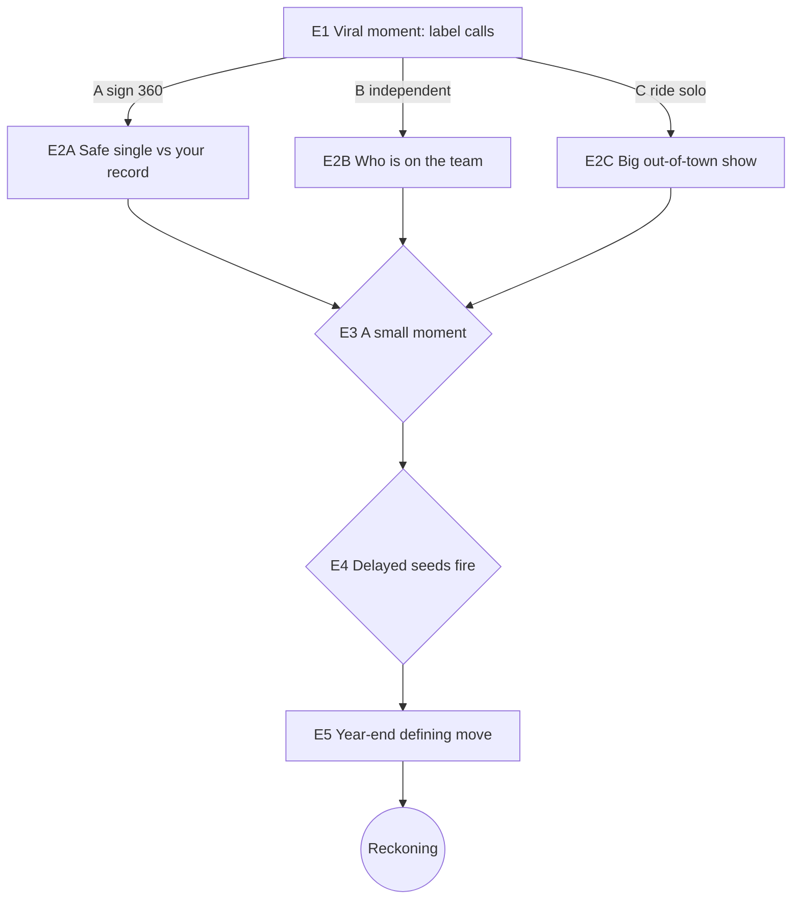

# Assume Their Life — Vertical-Slice Design v0.1

**Status:** **DESIGN ONLY — not authorization to code, migrate, deploy, or merge.**
**Date:** 2026-10-29
**Builds on:** `WahalaVerse-Assume-Their-Life-Causal-Simulation-Spec-v0.1.md` (the causal
requirements) and `ASSUME_THEIR_LIFE_SCENARIO_MAP.md` (the proven structural template,
demonstrated on a fictional tech-CEO).
**Purpose:** recommend the **first playable vertical slice** — one tightly authored,
reality-grounded role — per Spec §7 ("prototype *one* scenario first; don't build dozens
of profiles before the mechanics prove fun"). Everything marked 🎭 is illustrative and
open for founder review; it is not settled content, balance, or an engine decision.

---

## 1. Recommended first scenario

### 1.1 The pick: **"Breakout Year" — a rising Nigerian Afrobeats artist**

> **Role pack:** *Media figure / celebrity* (Spec §5). **Horizon:** one career-defining
> year, compressed into **~10 decisions** across **3 interwoven arcs**. **Fictional
> analogue, not a named real person** (see §6 content safety).

**Why this slice first (over the tech-CEO in the scenario map, or a Governor):**

| Criterion | Afrobeats artist | Tech-CEO (map template) | State Governor |
|---|---|---|---|
| Nigerian cultural relevance / WhatsApp virality | **Highest** — the WahalaVerse audience | Medium | High but heavier |
| Emotional relatability for 18–30s | **High** (fame, money, "blow" fantasy) | Medium | Medium |
| Defamation / political-sensitivity risk | **Low** (archetype, no real artist) | Low | **Higher** (real politics) |
| Reuses the proven engine structure | ✅ same state+event-graph shape | ✅ (it's the template) | ✅ |
| Content authoring cost for one slice | **Low–Medium** | Medium | **High** (policy systems) |
| Share-card punchiness | **Highest** ("You blew — but sold your masters") | Medium | Medium |

The Afrobeats "blow or flop" journey is the most *natively WahalaVerse* story: it's the
fantasy the audience already shares on WhatsApp, it's cheap to author well, and it
carries the least real-person risk because the role is an **archetype**, not a specific
celebrity. The tech-CEO map remains the structural reference; the Governor is the
recommended **second** slice once mechanics are proven.

### 1.2 Situation Brief (inherit a situation, not a title)

> 🎭 Fictional hypothetical. A real-figure build would instead use dated, sourced public
> baselines with "hypothetical — not affiliated/endorsed" labels (Spec §4–§5).

- **Role:** You are a buzzing Lagos Afrobeats artist. A freestyle you posted just went
  viral on TikTok overnight. Suddenly everyone — labels, promoters, blogs, old friends —
  wants a piece.
- **What you control:** what you release and when, which deals you sign, how you treat
  your team and fans, what you say publicly, how you spend your energy.
- **What you don't:** virality fades on its own; labels own what you sign away; fans and
  bloggers react how they want; you cannot buy a hit.
- **Starting tension:** the buzz window is short. A major label is dangling a cash
  advance + machine. Your day-one producer and manager are watching to see if you'll
  remember them. Rent is due.
- **Goal:** no single "win" — blow up, stay real, build something lasting, or protect
  your peace. Each costs something.

### 1.3 State variables (compact; celebrity role pack) — 🎭 illustrative starts

| Var | Meaning | Start |
|---|---|---|
| `cash` | Liquid cash (₦) | ₦250,000 |
| `buzz` | Hype / streams momentum (0–100) | 72 (spiking) |
| `fanTrust` | Core fanbase loyalty (0–100) | 60 |
| `cred` | Artistic / street credibility (0–100) | 65 |
| `media` | Blog/press sentiment (−100…100) | +15 |
| `energy` | Personal energy & mental health (0–100) | 70 |
| `control` | Ownership of your masters / independence (0–100) | 90 |
| `commitments[]` | Public & private promises the engine remembers | [] |
| `memory{}` | Stakeholder memories: `producer`, `manager`, `oldSquad`, `label`, `fans` | {} |
| `seeds[]` | Delayed events `{id, fireWeek, condition}` | [] |
| `flags{}` | e.g. `signed360`, `gaveMasters`, `skippedHomeShow`, `startedBeef`, `keptProducer` | {} |

**Event-selection rule (Spec §2):** at each step the engine picks the next event whose
**preconditions match current state + history**, and fires any due `seeds`. Never a
shuffled list of generic questions.

---

## 2. Interaction model (how a turn actually plays)

Each step: **Situation → choose an action → immediate reaction → updated life → the
*next* situation is selected from your state + history.** This is the Spec §3B loop,
tuned for mobile:

- You see only what the artist would plausibly know. Some outcomes are uncertain;
  gathering info (e.g. "ask your lawyer to read the contract") can cost time, cash, or a
  relationship.
- You can often **delay, negotiate, delegate, or decline** — and *doing nothing is also a
  choice with consequences* (the buzz can cool while you hesitate).
- Choices plant **delayed seeds** that fire weeks later and **reference the earlier
  decision by name** ("Remember that hometown show you skipped?").
- Money ≠ fame ≠ credibility ≠ peace. A cash advance can cost control; a viral diss can
  spike buzz but burn `cred` and `energy`.

**This is explicitly NOT a quiz:** there is no hidden "correct answer," options are
*actions* with trade-offs, and the same opening produces materially different mid- and
late-game situations depending on the path (proof in §4).

---

## 3. Consequence system — the event graph (🎭 illustrative)

Notation: `Δ` = immediate change; **→Exx** = next event on this path; **⏳seed** = delayed
consequence planted now, fires later if its condition holds.

### E1 — The viral moment: the big label calls *(inciting)*
| Choice | Δ immediate | → next | ⏳ delayed seed |
|---|---|---|---|
| **A. Sign the 360 deal for a big advance** | `cash +15,000,000`, `buzz +15`, `control −45`, `flags.signed360=true`; `commitments+=["deliver album in 12 months"]` | **→E2A** (label picks your first single) | ⏳`S_creativeclash@W20` if `cred>60` |
| **B. Stay independent, take a distribution deal** | `cash +2,000,000`, `control −10`, `energy −10` | **→E2B** (you must fund your own rollout) | ⏳`S_burnout@W16` if `energy<45` |
| **C. Ride the wave solo, sign nothing yet** | `cash 0`, `buzz −5` (no marketing push), `cred +8` | **→E2C** (a bigger bidding war — or the buzz cools) | ⏳`S_windowcloses@W10` if `buzz<60` |

### E2A — The label wants a safe pop single; you have a grittier record *(path A)*
| Choice | Δ | → next | ⏳ seed |
|---|---|---|---|
| **A1. Give them the pop single** | `buzz +10`, `cred −12`, `memory.fans −`, `memory.label +` | →E3 | ⏳`S_sellout@W14`: core fans call you a sellout if `cred<50` |
| **A2. Fight for your record** | `memory.label −`, `media −5`, `cred +6` | →E3 | ⏳`S_shelved@W18`: label quietly buries your project |
| **A3. Compromise: your record, their video budget** | `cash −3,000,000`, `cred +2`, `memory.label +` | →E3 | — |

### E2B — Self-funded rollout: who do you put on the team? *(path B)*
| Choice | Δ | → next | ⏳ seed |
|---|---|---|---|
| **B1. Keep your day-one producer & manager** | `energy +5`, `cred +6`, `flags.keptProducer=true`, `memory.producer +`, `memory.manager +` | →E3 | ⏳`S_loyaltypays@W17` (your team goes hard for you) |
| **B2. Hire an industry hit-maker, drop day-ones** | `cash −4,000,000`, `buzz +8`, `memory.oldSquad −`, `memory.producer −` | →E3 | ⏳`S_oldsquadtalks@W15`: ex-team airs grievances online |
| **B3. Try to keep everyone, stretch the budget** | `cash −6,000,000`, `energy −10` | →E3 | ⏳`S_cashcrunch@W13` if `cash<1,000,000` |

### E2C — Solo wave: a promoter offers a huge show, far from home *(path C)*
| Choice | Δ | → next | ⏳ seed |
|---|---|---|---|
| **C1. Take the big out-of-town show** | `cash +5,000,000`, `buzz +10`, `flags.skippedHomeShow=true` | →E3 | ⏳`S_homebacklash@W12`: hometown fans feel abandoned (fires harder during any later scandal) |
| **C2. Do the smaller hometown show first** | `cash +800,000`, `fanTrust +12`, `cred +6` | →E3 | — |
| **C3. Hold out for the bidding war** | `buzz −8` (momentum cools), `cash 0` | →E3 | ⏳`S_windowcloses@W10` armed |

### E3 — Mid-game: a "small" moment that matters *(precondition: always)*
> Demonstrates Spec #7 ("small actions can matter").
| Choice | Δ | → next | ⏳ seed |
|---|---|---|---|
| **F1. Subtweet a bigger artist for clout** | `buzz +12`, `media +5`, `cred ±`, `flags.startedBeef=true` | →E4 | ⏳`S_beefescalates@W19`: the bigger artist claps back (fires if `buzz>70`) |
| **F2. Stay humble, big up your city** | `fanTrust +8`, `media +2` | →E4 | — |
| **F3. Go quiet to focus on the music** | `energy +10`, `buzz −6`, `media −4` | →E4 | — |

### E4 — The delayed cascade fires *(seeds due ~W12–W20)*
Whichever seeds are armed fire here and **name the decision that caused them**:
- `S_sellout` → core fans turn → `fanTrust −20`, `cred −10`.
- `S_homebacklash` → "he forgot us" trends → `fanTrust −15`, `media −10` (worse if
  `flags.startedBeef`).
- `S_burnout` / `S_cashcrunch` → you crash → `energy −25` or a forced cheap deal.
- `S_beefescalates` → viral back-and-forth → `buzz +15` **but** `energy −15`, `cred ±`.
- `S_loyaltypays` → your day-ones deliver a surprise hit → `buzz +12`, `fanTrust +10`.
- If **no** seeds armed → a calmer **→E5** (a steady "what's next" beat).

### E5 — Year-end: the defining move *(week 48–52)*
Final posture (drop the album now / hold for a bigger moment / pivot to a brand deal /
step back to protect your peace) applies the last Δ, then → **Reckoning**. Pending
`commitments` are checked: a broken "album in 12 months" (if `flags.signed360`) fires a
label-dispute penalty — **the engine remembers**.

### 3.1 Endings (keyed to end-state + fired seeds) — 🎭 illustrative
Each ending ships with a **trace of the 3–5 pivotal decisions** that produced it — never a
single die-roll.

| Ending | Rough trigger | Why (explainable) |
|---|---|---|
| **Global Breakout** | `buzz≥80 & fanTrust≥65 & control≥50` | You blew up *and* kept your people and your ownership. |
| **Label Puppet** | `cash≥10M & control<40 & cred<50` | The bag was real; you signed yourself away and lost the plot. |
| **Street Legend, Small Bag** | `cred≥75 & fanTrust≥70 & cash<3M` | You kept it 100 and the fans love you — the money just didn't follow (yet). |
| **One-Hit Wonder** | `buzz<45` after an early spike | The window closed while you hesitated or chased the wrong move. |
| **Burnt Out** | `energy<30` | You ran yourself into the ground; the music suffered. |
| **Cancelled** | `media<−25` + (`S_sellout` or `S_homebacklash` or beef) fired | A reputation cascade you set in motion caught up with you. |
| **Steady Come-Up** | middling across the board | No explosion, no disaster — a real, sustainable career start. |

**Reckoning report (Spec §3D):** dated start-vs-simulated-end per dimension (buzz, cash,
cred, control, fanbase, peace); a short story of your year; the 3–5 pivotal decisions and
their downstream effects; the delayed consequences that surprised you; the opportunities
on the paths you didn't take. A **WhatsApp share card** teases the headline — e.g. *"You
went global — but you don't own a single master"* — and links back to play. Never implies
endorsement by any real artist.

---

## 4. Two divergent playthroughs (proof it is not a reskinned quiz)

**Player X — "chase the bag":** E1→**A** (sign 360) → E2A→**A1** (pop single) → E3→**F1**
(start beef) → E4: `S_sellout` + `S_beefescalates` fire → E5 holds the album, but the
"album in 12 months" commitment is now at risk. **Ending: Label Puppet / Cancelled**
(depending on `media`). Trace: the 360 signing + the pop single + the beef were pivotal.

**Player Y — "build it right":** E1→**B** (independent) → E2B→**B1** (keep day-ones) →
E3→**F2** (stay humble) → E4: `S_loyaltypays` fires (surprise hit) → E5 drops the album.
**Ending: Global Breakout** (buzz 84, fanTrust 78, control 80). Trace: staying independent
+ keeping the team + humility compounded.

Same viral opening — **materially different circumstances and endings** — because the
engine remembered the deal, the single, the team, and the promises. Neither path is the
"right answer": X traded control and credibility for cash and buzz; Y traded quick money
for ownership and loyalty.

---

## 5. Visual experience (mobile-first, cheap, on-brand)

Reuses the existing WahalaVerse look (navy base, neon-lime accent, bundled DM Sans /
Space Grotesk). No heavy media, so it stays fast on Nigerian mobile data and costs
little.

- **Life dashboard (persistent top strip):** compact stat meters — 💰 cash, 🔥 buzz,
  💚 fans, 🎤 cred, 🧠 energy, 🪙 control — that **animate on change** (a `+12 buzz`
  floats up in lime; a drop flashes amber). This is the "inhabiting a life" anchor.
- **Situation card:** a full-bleed scene with a short, voice-y Naija narrative ("Omo, the
  label don call. The advance fit change your life — but you go still be your own boss?"),
  a small "Week N / 52" + arc tag, and 2–4 **action** buttons (not lettered quiz
  options — verbs: *Sign it. / Negotiate. / Walk away.*).
- **Immediate-reaction beat:** after a choice, a brief consequence line + the meter
  animation *before* the next card, so cause→effect is felt.
- **Consequence ticker:** when a delayed seed fires, a "⏳ 8 weeks later…" banner that
  explicitly names the earlier decision.
- **Reckoning screen:** before→after bars per dimension, the illustrated 3–5-decision
  trace ("your turning points"), the ending title, and a **share card** with a punchy
  headline for WhatsApp.
- **Accessibility:** semantic buttons, keyboard/focus support, meter changes conveyed by
  text + colour (not colour alone), large touch targets — consistent with the existing
  CLAUDE.md non-negotiables.

**Tone:** authentic Nigerian humour and warmth, never punching down (CLAUDE.md §8).

---

## 6. Content safety & grounding

- **Fictional archetype, not a named person.** The first slice depicts *a* rising
  Afrobeats artist, not any specific real artist — this satisfies "recognizable public
  role" while eliminating defamation risk. No real private details, misconduct, or
  quotes are invented about anyone.
- If a **named real figure** is ever used later, it must follow Spec §4–§5: dated,
  sourced public baselines; paper net worth labelled as an estimate, not spendable cash;
  clear "hypothetical role simulation — not affiliated with or endorsed by" labelling;
  fictional branches clearly separated from historical/public fact.
- Scores and endings are a **simulation**, not predictions or claims about the real
  industry. No prizes/monetary use (the result is browser-computed; same caveat as the
  quiz links).

---

## 7. Development complexity (estimate, not a commitment)

**Shape:** a **client-only, guest-first** module — conceptually Survive Naija's successor
but **stateful + branching**, matching the existing framework-free architecture. No new
backend, no paid services, no change to M2 auth.

| Piece | What it is | Rough effort |
|---|---|---|
| **Engine core** (`atl-engine.js`, pure + Node-testable like `core.js`) | state model; apply deltas/sets with clamping; fire due seeds; select next event by matching preconditions against state+history; deterministic seed; resolve ending + build trace | Medium — the real work; small, unit-testable rule core |
| **Role pack** (`atl-pack-afrobeats.json`) | ~10–14 authored events with preconditions, choices → `{deltas, sets, next, seed}`, seeds, endings, Reckoning copy | Medium — mostly writing/balancing, not code |
| **UI** (extends `app.js` render + `styles.css`) | dashboard meters, situation card, reaction beat, consequence ticker, Reckoning + share card | Medium |
| **Tests** | unit: deterministic run, divergent paths differ, seed fires + names cause, constraints hold, every ending reachable; E2E: guest plays a full run → Reckoning → share | Low–Medium (mirrors existing suites) |
| **Save/resume** | optional `localStorage` run state (guest-first; no backend) | Low |

**Risks:** balancing (making trade-offs feel fair, not punishing) is the main iteration
cost; authoring voice-y Naija copy at quality takes care. Scope is deliberately **one**
role pack first (Spec §7) — do not author multiple profiles before this proves fun.

**Cost:** ~₦0 infra — static files only, reuses current hosting. Fits CLAUDE.md
non-negotiable #1 (simple, inexpensive).

---

## 8. Acceptance criteria (maps to Spec §7 gates)

A prototype of this slice is acceptable only if:

1. **Different early choices → materially different later circumstances** (X vs Y in §4),
   not merely reworded feedback.
2. **A later event references an earlier action/omission** by name (seeds in E4 cite the
   decision that armed them; E5 checks remembered commitments).
3. **All effects obey constraints** — meters clamp to their ranges; `control` can't exceed
   100; a cash advance genuinely costs ownership; buzz can fade without player action.
4. **Setbacks are understandable; several strategies stay viable** — ≥5 reachable endings,
   no forced failure; "stay independent," "chase the bag," and "keep it real" are all
   coherent routes.
5. **The player can see *why* their ending differed from the start** — the Reckoning trace
   names the 3–5 pivotal decisions and their downstream effects.
6. **Replay changes the causal experience** without fabricating facts about any real
   person (fictional archetype).
7. **Guest-first mobile web + WhatsApp sharing retained** — a full run is playable with no
   sign-up; the Reckoning produces a shareable card; performs on midrange Android.
8. **It does not read as a quiz** — options are actions with trade-offs; no hidden correct
   answer; the next situation is selected by state, not a fixed order.

---

## 9. What this does NOT do / open founder decisions

- **No implementation here.** This is the pre-build design the Spec requires before
  coding. Build happens later, on its own branch/PR, only with founder approval.
- **No change to M2 (PR #2), CYOW (PR #4), or privacy hardening (PR #5).**
- Open for the founder to decide: per-role horizon/decision count, how much authored content
  vs future variation, visual depth, and whether any scenario uses a named public figure
  (which then triggers the Spec §4–§5 sourcing/labelling rules).
- Audience/age policy is still open (tracked in Track B) and does not block this design.

> **Note (2026-10-29):** §1–§8 document the Afrobeats slice as the engine spike. Per the
> founder correction, Afrobeats is **one additional role**, not a gate. The **active core
> scope and program plan are in §10–§11** — Billionaire, CEO, Founder and Political proceed
> independently of Afrobeats acceptance.

---

## 10. Active core scope — four core role experiences (CORRECTED 2026-10-29)

> **Founder correction (supersedes any earlier "Afrobeats-first gate" framing in this
> document and in the Spec §7–§8 "prototype one first" note).** Assume Their Life is
> primarily a **consequential, intellectually engaging simulation of different lives,
> responsibilities, opportunities, decisions and outcomes.** The four role experiences
> below are **ACTIVE core development scope — NOT postponed future features, and NOT
> contingent on Afrobeats acceptance.** There is **no dependency** making any of them wait
> on the Afrobeats prototype.

**The four active core roles:**
1. **Billionaire Life** 2. **CEO Life** 3. **Founder Life** 4. **Political Leadership**

> **Each is a distinct life with distinct systems** — never one template with a swapped
> name:
> - **A CEO is not necessarily the founder; a billionaire is not necessarily the CEO.**
> - **Founder ≠ CEO:** a Founder lives the 0→1 journey (starting/growing, funding,
>   ownership dilution, product–market fit, hiring, partnerships, scaling, failure,
>   personal sacrifice). A CEO leads an *already-operating* company (shareholders, board
>   governance, executive decisions, employees, operations, competition, financial
>   performance, crises, accountability) and may be a hired executive who never founded it.
> - **Billionaire ≠ CEO:** a Billionaire is a *capital/ownership* life (diversified
>   holdings, liquidity vs paper wealth, deals, influence, family interests, preservation
>   and loss) — may hold no operating role at all.

**Afrobeats (Celebrity):** the existing playable prototype (§1–§8) remains **an additional
role and a reusable technical experiment** that proved the engine end-to-end. It is **not**
the flagship, not the product's primary goal, and **not a mandatory approval gate** for any
other role.

Every role must deliver **genuine agency, evolving circumstances, resources, relationships,
constraints and delayed cascading consequences** with an explainable outcome — **not**
generic multiple-choice quizzes and **not** "just change a number after a decision." None
may be reduced to simple money/reputation meters.

**Real public figures (optional):** where a scenario references a real person, **ground the
starting facts in verifiable public information** and clearly **distinguish the fictional
alternate outcomes** from fact (per Spec §4–§5: dated/sourced baselines, paper wealth ≠
cash, "hypothetical — not affiliated/endorsed" labelling, no invented defamatory claims).
Role-based archetypes remain the safe default, especially for Political Leadership.

---

## 11. Coordinated implementation breakdown (four core roles)

Each role is a **role pack** (data + a little role logic) on the shared `atl-engine.js`.
The breakdown below gives, per role, its core systems, state variables, signature
decisions, an example delayed cross-domain cascade, and ending axes — plus the
**engine reuse vs expansion** analysis the founder asked for.

### 11.A Billionaire Life
- **Core systems:** diversified **holdings portfolio** (`custom.portfolio[]`: equity
  stakes, property, private companies — each with value + liquidity + volatility), **debt &
  leverage**, **influence/soft power**, **family interests & succession**, legal/regulatory
  exposure, lifestyle burn. **Paper net worth ≠ spendable cash** (hard constraint).
- **State vars:** `liquidCash`, `netWorth` (derived), `leverage`, `influence`,
  `familyTrust`, `legalExposure`. Stakeholders: family, co-investors, regulators, press, a
  key adviser.
- **Signature decisions:** liquidate a stake vs borrow against it; back a risky venture;
  take a company private; settle vs fight a lawsuit; succession/philanthropy vs expansion.
- **Example cascade:** over-leverage to fund a trophy deal (W2) → a market downturn seed
  (W14) margin-calls you → forced fire-sale of a prized holding (W20) at a loss, denting
  influence and family trust.
- **Ending axes:** wealth preserved/grown vs eroded; influence; family; legal standing;
  legacy (e.g. *Dynasty Builder*, *Overleveraged*, *Cashed Out, Diminished*, *Quiet Power*).

### 11.B CEO Life (leads an existing company)
- **Core systems:** **operations & financial performance**, **board governance &
  shareholders**, executive team, employees/morale, competition/market share, crisis &
  **public accountability**. The CEO serves at the board's pleasure (can be removed).
- **State vars:** `revenue`/`margin`, `cashRunway`, `boardConfidence`, `morale`,
  `marketShare`, `reputation`. `custom.capTable` (board/ownership) read-mostly here.
  Stakeholders: chair/board, CFO, a key customer, regulator, press.
- **Signature decisions:** hit the quarter vs invest long-term; layoffs vs burn; a risky
  acquisition; handle an outage/recall/scandal; activist investor demands.
- **Example cascade:** cut R&D to beat a quarter (W3) → a competitor ships (W12) → market
  share slides → board confidence seed fires (W20) → forced strategy review / ouster risk.
- **Ending axes:** company health, shareholder value, your tenure (kept/removed),
  reputation (*Turnaround Hero*, *Boardroom Casualty*, *Short-Term Winner, Long-Term Loser*).

### 11.C Founder Life (0→1 and scaling)
- **Core systems:** **product–market fit**, **fundraising & ownership dilution**
  (`custom.capTable` actively mutated), hiring/culture, co-founder & partner relationships,
  burn/runway, scaling vs failure, **personal sacrifice** (health/relationships).
- **State vars:** `cash`/`runway`, `traction` (PMF), `ownership` (founder %), `team`,
  `cofounderTrust`, `wellbeing`. Stakeholders: co-founder, investors, first big customer,
  early employees.
- **Signature decisions:** bootstrap vs raise (dilute); pivot vs persevere; hire fast vs
  stay lean; take a predatory term sheet to survive; push the team vs protect your health.
- **Example cascade:** accept a dilutive down-round with aggressive terms (W6) → an investor
  liquidation-preference seed (W22) means a later "good" exit pays the founder little —
  tracing directly to the term sheet.
- **Ending axes:** survival/scale, ownership retained, team/relationships, wellbeing
  (*Venture Scaled*, *Diluted to Nothing*, *Profitable & Independent*, *Burned Out, Folded*).

### 11.D Political Leadership
- **Core systems:** **institutions & separation of powers**, **public budget** (fixed pool,
  competing priorities), **legislature/coalition** (vote math), policy feasibility, security,
  cabinet trust, citizens & **long-term public accountability**, media/diplomacy. Cannot act
  unilaterally.
- **State vars:** `approval`, `fiscalBalance`, `coalition`, `serviceDelivery` (derived),
  `institutionalTrust`, `unrest`. Stakeholders: cabinet, legislature bloc, citizens, press,
  a foreign counterpart. `custom.budget` allocation via `ops`.
- **Signature decisions:** allocate the budget across priorities; spend political capital to
  pass a reform; respond to an emergency/protest; cabinet appointment/dismissal; a
  diplomatic trade-off.
- **Example cascade:** divert the capital budget to a popular subsidy (W4) → infrastructure
  decay seed (W24) → a service failure + unrest → approval and institutional trust fall,
  tracing to the earlier allocation.
- **Ending axes:** approval, delivery, fiscal stability, institutions, legacy
  (*Reformer*, *Populist Flameout*, *Caretaker*, *Institution Builder*). **Role-based, not a
  named real politician in beta.**

### 11.E Engine REUSE vs EXPANSION
**Reused as-is (no engine change):** the entire `atl-engine.js` core — deterministic state +
clamping, `vars` (per-role), `memory`, `commit`, `seeds` (delayed consequences with
fire-time conditions), state+history event selection, `endings`, and the **Reckoning**
(before→after, fired-consequence trace, pivotal decisions). The Afrobeats pack already
exercises all of this. `choice.ops(run)` + `pack.derive(run)` are the declared seams for
role-specific systems.

**New, as small REUSABLE sub-system helpers (shared modules, authored once, used by multiple
packs — engine stays generic):**
| Sub-system | Needed by | Shape |
|---|---|---|
| `capTable` (ownership %, dilution on raise, liquidation prefs, control) | Founder, CEO, Billionaire | pure helper mutated inside `choice.ops`; `derive` surfaces `ownership`/`control` |
| `portfolio` (holdings with value/liquidity/volatility; net-worth, market-shock) | Billionaire (+CEO equity) | pure helper over `custom.portfolio[]`; `derive` computes `netWorth` |
| `budget` (fixed pool, allocations, derived delivery, deficit) | Political | pure helper over `custom.budget`; `derive` computes `serviceDelivery` |
| `voteCount` (coalition/bloc support → pass/fail a measure) | Political (+ board votes for CEO) | pure helper reading `memory`/`coalition` |

**Also expands (content, not engine):** a role-selection screen (choose which life), and
per-pack authored events/endings/copy. Optional UI: a couple of role-specific dashboard
affordances (e.g. a portfolio/cap-table mini-view) — additive, behind the existing render.

**What does NOT need building twice:** scoring, determinism, seeds, memory, Reckoning,
share-cards, routing, tests harness — all shared.

### 11.F Program sequencing (NOT gated on Afrobeats)
All four are active scope and proceed as an independent program. Proposed order balances
reuse and value; it is a **recommendation, not a gate** — the founder may reorder:
1. **Founder Life** — introduces the reusable `capTable` helper; richest decision space.
2. **CEO Life** — reuses `capTable`; adds board/ops systems.
3. **Billionaire Life** — adds the `portfolio` helper.
4. **Political Leadership** — adds `budget` + `voteCount` helpers.
Each ships on its own branch/PR with deterministic unit tests (transitions, ≥2 traced
delayed consequences, divergent outcomes) + an E2E full-run-to-Reckoning, mirroring the
Afrobeats spike. Afrobeats is **not** a prerequisite for any of them.

_Next concrete step: begin **Founder Life** (pack + the shared `capTable` helper + tests) on
a dedicated branch, in parallel with founder acceptance of CYOW/Afrobeats — no merge/deploy._
